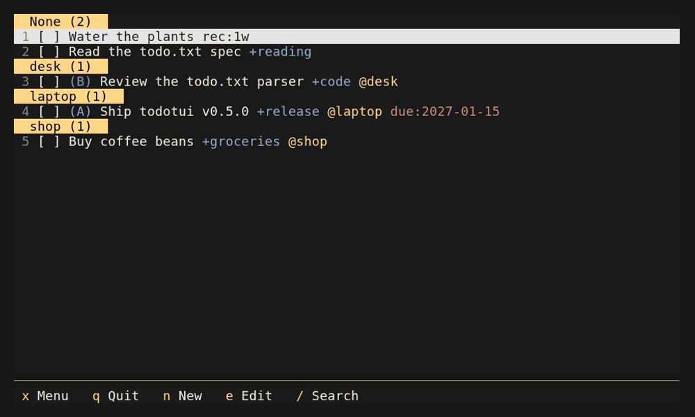

# Thar

A keyboard-driven [todo.txt](https://github.com/todotxt/todo.txt) TUI for the
terminal.



## Install

```sh
npm install -g @arnoarnoarno/thar
```

Or run it without installing:

```sh
npx @arnoarnoarno/thar
```

Requires Node.js 22.12 or newer.

## Usage

```sh
thar                 # opens ./todo.txt
thar work.txt        # opens work.txt
thar --help
```

The todo file is created if it does not exist. Completed items are archived to
`done.txt` next to it.

| Key       | Action                |
| --------- | --------------------- |
| `↑` / `↓` | Move selection        |
| `Space`   | Complete todo         |
| `n` / `e` | New / edit todo       |
| `/`       | Search                |
| `x`       | Open the command menu |
| `q`       | Quit                  |

Supports projects (`+project`), contexts (`@context`), priorities, due dates,
threshold dates, recurrence, and hidden todos. Run `thar --help` for options
and see the [todo.txt format](https://github.com/todotxt/todo.txt) for tags.

## License

[MIT](LICENSE)
