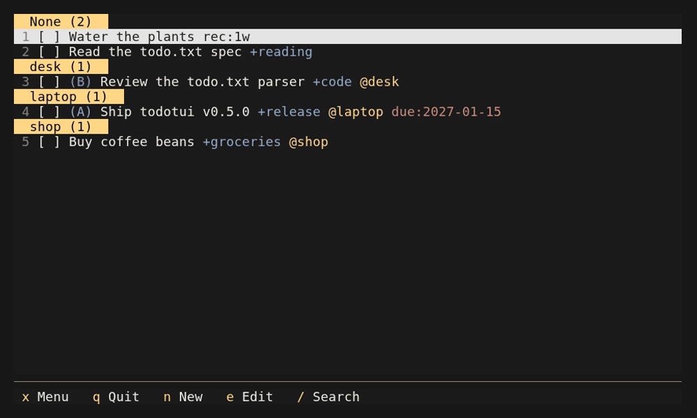

# Thar

A keyboard-driven [todo.txt](https://github.com/todotxt/todo.txt) TUI for the
terminal.



## Install

```sh
npm install -g @arnoarnoarno/thar
```

Or run it without installing:

```sh
npx @arnoarnoarno/thar
```

Requires Node.js 22.12 or newer.

## Usage

```sh
thar                 # opens ./todo.txt
thar work.txt        # opens work.txt
thar --help
```

The todo file is created if it does not exist. Completed items are archived to
`done.txt` next to it.

| Key       | Action                |
| --------- | --------------------- |
| `↑` / `↓` | Move selection        |
| `Space`   | Complete todo         |
| `n` / `e` | New / edit todo       |
| `/`       | Search                |
| `x`       | Open the command menu |
| `q`       | Quit                  |

Supports projects (`+project`), contexts (`@context`), priorities, due dates,
threshold dates, recurrence, and hidden todos. Run `thar --help` for options
and see the [todo.txt format](https://github.com/todotxt/todo.txt) for tags.

## Rust port (development)

The `todo.txt` domain is being ported to Rust in `crates/` and loaded through
WebAssembly. Nothing in the shipped app changes yet: the TypeScript
implementation is still the source of truth, no `wasm` package is published, and
both variables below are development-only.

```sh
wasm-pack build crates/thar-wasm --release --target nodejs --out-dir pkg
```

| Variable          | Effect                                                                                                                                                                                                                                                                                                                                                                                                     |
| ----------------- | ---------------------------------------------------------------------------------------------------------------------------------------------------------------------------------------------------------------------------------------------------------------------------------------------------------------------------------------------------------------------------------------------------------- |
| `THAR_CORE=ts`    | Default. Only value that is live today; `rust` is read but behaves identically until CP3.                                                                                                                                                                                                                                                                                                                  |
| `THAR_SHADOW=1`   | After each successful load, parse the same text with the Rust core and compare per-todo `toString`/`hash` and the serialized file. Off by default; never changes state, saves or toasts. One record is appended **per load** that differs (a file that keeps disagreeing appends on every load; the 64 KiB cap eventually drops the oldest records), while the `console.warn` summary is once per process. |
| `THAR_SHADOW_LOG` | Shadow log path. Default `<cache>/thar/shadow.log` (`$XDG_CACHE_HOME`, `~/Library/Caches`, `%LOCALAPPDATA%`, else `~/.cache`). Records counts, line indexes and 16-hex-digit SHA-256 digests only — never todo text. Capped at 64 KiB; the file is truncated before an append would exceed the cap.                                                                                                        |
| `THAR_CORE_WASM`  | Explicit path to `thar_wasm.js`, for experiments outside the checkout.                                                                                                                                                                                                                                                                                                                                     |

A missing or broken package disables the Rust path silently (one `console.debug`
line), so the app and its tests work in a clean checkout without Rust. See
[`docs/rust-port/PLAN.md`](docs/rust-port/PLAN.md) and
[`tools/port/README.md`](tools/port/README.md).

## License

[MIT](LICENSE)
